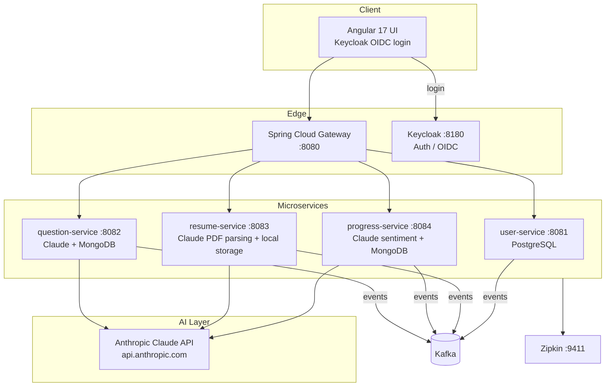

# CareerPilot — AI-Powered Interview Prep Platform

Full-stack platform: Spring Boot 3 microservices + Angular 17 + the **Anthropic Claude API** (question generation, resume parsing, sentiment analysis), secured by Keycloak, wired together with Kafka.

**Why this project:** demonstrates microservices, event-driven design (Kafka SAGA + Outbox), distributed tracing, OIDC security, and LLM integration behind a clean vendor-agnostic seam — ideal portfolio piece for product-company interviews.

---

## 1. Architecture



### Event flow (the SAGA loop)
1. User uploads a resume → Claude extracts skills → `resume.parsed` event on Kafka
2. user-service consumes it, updates the profile, and (same DB transaction) inserts an **Outbox** row
3. The Outbox poller publishes `profile.updated`
4. question-service consumes it and pre-generates a tailored question set (success/failure events close or compensate the saga)
5. After each practice answer, `session.completed` updates weak-area stats in progress-service
6. The Angular roadmap shows weakest areas first — re-prioritized after every session

---

## 2. Local setup — prerequisites

| Tool | Version | Purpose |
|---|---|---|
| Java (JDK) | 17+ (tested on 25) | Spring Boot 3 services |
| Maven | 3.9+ | build |
| Node.js | 20+ | Angular |
| Docker Desktop | latest | Postgres, Mongo, Kafka, Keycloak, Zipkin |
| Anthropic API key | — | https://console.anthropic.com → API Keys |

> **JDK 23+ note:** javac disables annotation processing by default; the poms set
> `maven.compiler.proc=full` and a current Lombok so builds work out of the box.

### 2.1 Set your Claude API key (once)
```bat
setx ANTHROPIC_API_KEY "sk-ant-..."
```
All three AI-touching services read it from the environment (`ai.api-key` in each `application.yml`; model configurable via `ai.model`).

### 2.2 Start infrastructure
```bash
cd careerpilot
docker compose up -d        # postgres, mongo, kafka, keycloak, zipkin
```

### 2.3 Keycloak realm (first time)
Run `scripts/keycloak-setup.bat` — creates realm `careerpilot`, public client
`careerpilot-ui` (redirect `http://localhost:4200/*`) and test user **demo / demo123**.
(Manual alternative: http://localhost:8180, admin/admin.)

### 2.4 Build & run everything
```bat
scripts/build-backend.bat     :: mvn package for all five services
scripts/run-services.bat      :: starts the five jars + ng serve, logs to .\logs\
```
Or per service after a change: `scripts/rebuild-<service>.bat` (stops, rebuilds, restarts).

| Service | Port |
|---|---|
| api-gateway | 8080 |
| user-service | 8081 |
| question-service | 8082 |
| resume-service | 8083 |
| progress-service | 8084 |
| Angular UI | 4200 |
| Keycloak | 8180 |
| Zipkin | 9411 |

Open **http://localhost:4200**, log in with **demo / demo123**, upload a resume, start practicing.

---

## 3. The AI layer (vendor-agnostic)

Each service owns exactly one thin AI wrapper — swapping the LLM vendor is a one-class change per service (these classes replaced an earlier AWS Bedrock/Textract/Comprehend implementation; the current provider is Anthropic):

| Service | Class | What the AI does |
|---|---|---|
| question-service | `AiService` | generates tailored questions; scores answers with strengths/gaps/improved answer |
| resume-service | `AiDocumentService` | reads the PDF/image natively (no OCR step) and extracts skills semantically |
| progress-service | `AiSentimentService` | confidence/tone signal on answers |

Implementation notes worth mentioning in interviews:
- Responses are parsed by collecting **all `text` content blocks** (newer models may emit a thinking block first).
- `temperature` is omitted (deprecated on current models).
- Resume files are stored locally under `resume-uploads/` (S3 in a cloud deployment).

---

## 4. Distributed tracing, SAGA & security (implemented)

### Distributed tracing (Micrometer -> Zipkin)
- Every service ships `micrometer-tracing-bridge-brave` + `zipkin-reporter-brave`
- Zipkin runs via docker-compose -> **http://localhost:9411**
- `sampling.probability: 1.0` in dev (drop to 0.1 in prod)
- Trace context propagates over HTTP (gateway -> services) and through Kafka
  headers, so one trace covers:
  `gateway -> resume-service -> Kafka -> user-service -> Kafka -> question-service -> Claude`

### SAGA: "Start Prep Plan" (choreography + Outbox)
```
resume upload
  └─ resume-service ── resume.parsed ──► user-service
                                           │  (same DB TX: update profile
                                           │   + insert outbox row)
                                           └─ Outbox poller ── profile.updated ──► question-service
                                                                                     │
                                                             success ◄──────────────┤
                                                     questions.generated            │ failure
                                                                                     ▼
                                           user-service ◄────────────────── plan.failed
                                           (COMPENSATION: revert skills)
```
Key files:
- `user-service/.../saga/OutboxEvent.java` — outbox table (solves dual-write)
- `user-service/.../saga/OutboxPublisher.java` — poller (Debezium CDC = prod alternative)
- `user-service/.../saga/ResumeParsedListener.java` — saga step + compensation handler
- `question-service/.../ProfileUpdatedListener.java` — pivot step, emits success/failure

Interview talking points baked into comments: dual-write problem, at-least-once
delivery -> idempotent consumers, choreography vs orchestration trade-offs,
compensation vs rollback.

### Security (defense-in-depth)
- Angular logs in via **Keycloak OIDC** (`keycloak-angular`); a bearer interceptor
  attaches the JWT to every API call
- The gateway permits CORS preflight (`OPTIONS`) explicitly — resource servers
  otherwise 401 preflights, which browsers surface as opaque "network" errors
- ALL five services validate the Keycloak JWT themselves (oauth2 resource server) —
  the gateway is not a single point of trust
- Only `/actuator/**` is open (health checks)

---

## 5. Cloud deployment (reference)

The `aws/` folder keeps the ECS Fargate task definitions, deployment guide and the
agent Action-Group OpenAPI schema fro