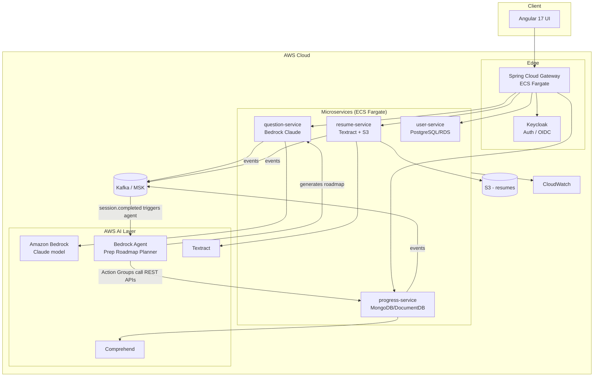

# CareerPilot — AI-Powered Interview Prep Platform

Full-stack, cloud-native platform: Spring Boot 3 microservices + Angular 17 + AWS AI (Bedrock, Bedrock Agents, Textract, Comprehend), deployable on AWS ECS Fargate.

**Why this project:** demonstrates microservices, event-driven design (Kafka), agentic AI orchestration, and end-to-end AWS deployment — ideal portfolio piece for product-company interviews.

---

## 1. Architecture



### Event flow (the agentic loop)
1. User completes a mock-interview session → `practice` event on Kafka topic `session.completed`
2. progress-service consumes it, updates weak-area stats in MongoDB
3. A Lambda (or scheduled task) invokes the **Bedrock Agent**
4. The Agent calls progress-service via an **Action Group** (OpenAPI schema) → reads weak areas
5. Agent decides next focus (DSA topic / system design / behavioral) → writes updated roadmap via question-service API
6. Angular dashboard shows the refreshed roadmap

---

## 2. Local setup — prerequisites

| Tool | Version | Purpose |
|---|---|---|
| Java (Temurin/Corretto) | 17 | Spring Boot 3 services |
| Maven | 3.9+ | build |
| Node.js | 20 LTS | Angular |
| Angular CLI | 17 | `npm i -g @angular/cli` |
| Docker Desktop | latest | Postgres, Mongo, Kafka, Keycloak |
| AWS CLI v2 | latest | `aws configure` with your IAM keys |
| AWS account | — | Bedrock model access enabled (see §5) |

### Start infrastructure
```bash
cd careerpilot
docker compose up -d        # postgres, mongo, kafka, keycloak
```

### Run backend services (each in a terminal)
```bash
cd backend/user-service      && mvn spring-boot:run   # :8081
cd backend/question-service  && mvn spring-boot:run   # :8082 (needs AWS creds)
cd backend/resume-service    && mvn spring-boot:run   # :8083 (needs AWS creds)
cd backend/progress-service  && mvn spring-boot:run   # :8084
cd backend/api-gateway       && mvn spring-boot:run   # :8080
```

### Run frontend
```bash
cd frontend/careerpilot-ui
npm install
ng serve                     # http://localhost:4200
```

### Keycloak (first time)
1. http://localhost:8180 → admin/admin
2. Create realm `careerpilot`, client `careerpilot-ui` (public, redirect `http://localhost:4200/*`)
3. Create a test user.

---

## 3. AWS credentials for local dev
```bash
aws configure   # access key, secret, region: us-east-1
```
The AWS SDK picks these up automatically (DefaultCredentialsProvider). Needed IAM permissions for dev: `bedrock:InvokeModel`, `textract:*`, `comprehend:Detect*`, `s3:PutObject/GetObject` on your bucket.

## 4. Enable Bedrock model access
AWS Console → Bedrock → Model access → request **Anthropic Claude** (e.g. Claude Sonnet). Takes a few minutes.

## 5. Bedrock Agent setup
See `aws/bedrock-agent/README.md` — includes the agent instructions and the OpenAPI schema for the progress-service Action Group.

## 6. Deploy to AWS
See `aws/ecs/README.md` — ECR push + ECS Fargate task definitions + RDS/DocumentDB/MSK notes.

---

## Repo layout
```
careerpilot/
├── docker-compose.yml          # local infra
├── backend/
│   ├── api-gateway/            # Spring Cloud Gateway + Keycloak resource server
│   ├── user-service/           # profiles (PostgreSQL)
│   ├── question-service/       # Bedrock: question generation + answer feedback
│   ├── resume-service/         # S3 upload + Textract parsing
│   └── progress-service/       # weak areas, Kafka consumer, Comprehend sentiment
├── frontend/careerpilot-ui/    # Angular 17
├── aws/
│   ├── bedrock-agent/          # agent instructions + action group OpenAPI schema
│   └── ecs/                    # deployment guide + sample task definition
└── docs/architecture.md
```
---

## 7. Distributed tracing, SAGA & security (implemented)

### Distributed tracing (Micrometer Tracing -> Zipkin)
- Every service ships `micrometer-tracing-bridge-brave` + `zipkin-reporter-brave`
- Zipkin runs locally via docker-compose -> **http://localhost:9411**
- `sampling.probability: 1.0` in dev (drop to 0.1 in prod)
- Trace context propagates automatically over HTTP (gateway -> services) and
  through Kafka headers (producer -> consumer), so one trace covers:
  `gateway -> resume-service -> Kafka -> user-service -> Kafka -> question-service -> Bedrock`
- On AWS: point the endpoint at an X-Ray/ADOT collector sidecar instead

### SAGA: "Start Prep Plan" (choreography + Outbox)
```
resume upload
  └─ resume-service ── resume.parsed ──► user-service
                                           │  (same DB TX: update profile
                                           │   + insert outbox row)
                                           └─ Outbox poller ── profile.updated ──► question-service
                                                                                     │
                                                             success ◄──────────────┤
                                                     questions.generated            │ failure
                                                                                     ▼
                                           user-service ◄────────────────── plan.failed
                                           (COMPENSATION: revert skills)
```
Key files:
- `user-service/.../saga/OutboxEvent.java` — outbox table (solves dual-write)
- `user-service/.../saga/OutboxPublisher.java` — poller (Debezium CDC = prod alternative)
- `user-service/.../saga/ResumeParsedListener.java` — saga step + compensation handler
- `question-service/.../ProfileUpdatedListener.java` — pivot step, emits success/failure

Interview talking points baked into comments: dual-write problem, at-least-once
delivery -> idempotent consumers, choreography vs orchestration trade-offs,
compensation vs rollback.

### Security (defense-in-depth)
- ALL five services validate the Keycloak JWT themselves (oauth2 resource server) —
  the gateway is not a single point of trust
- Service-to-service / agent calls: use a Keycloak client-credentials token
- Only `/actuator/**` is open (for ECS health checks)
